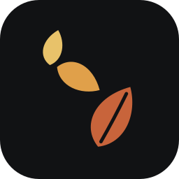
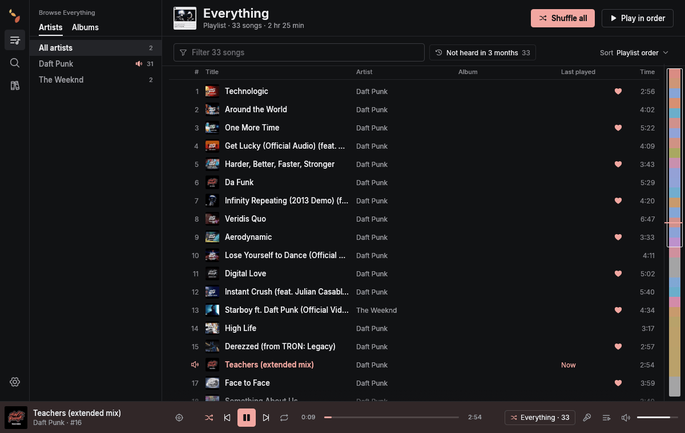
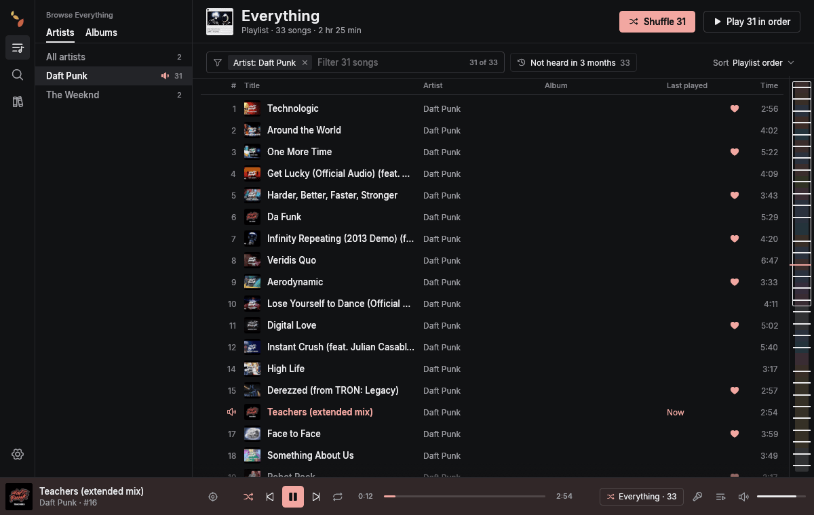
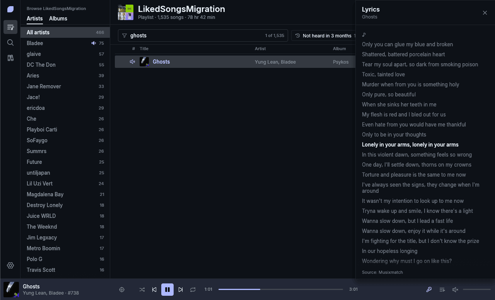
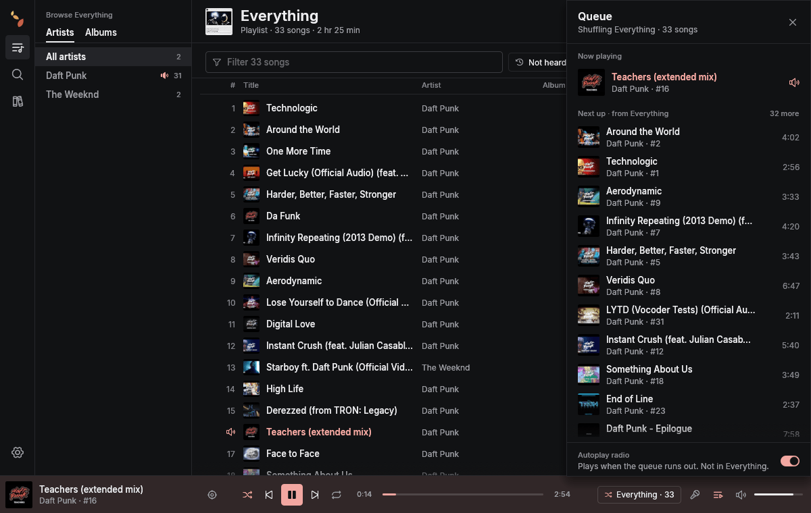
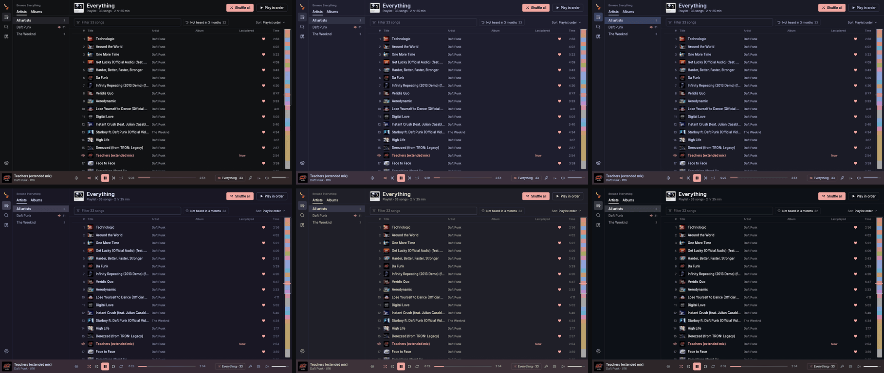

<p align="center">
  
</p>

<h1 align="center">Rustle</h1>

<p align="center">
  A native YouTube Music desktop client in Rust. No browser engine, one big playlist at the center.
</p>

<p align="center">
  
  
  
  
  
</p>

<p align="center">
  
</p>

## Why Rustle

Most people who live in one giant playlist get a client built for curating dozens. Rustle is
built the other way round: the main playlist **is** the app. It opens straight into it, lets
you narrow 1,500 songs down in a keystroke, and shuffles exactly what you see.

It is also small. Rustle draws its UI with egui on the GPU, plays audio with its own decoder
pipeline, and never starts a browser engine.

| Measure | Result | Budget |
| --- | --- | --- |
| Release binary | **21.2 MB** | 25 MB |
| Peak RAM, 33-song demo | **117.7 MB** | 150 MB |
| Peak RAM, 1,535-song library with album art | **138.1 MB** | 150 MB |
| Cold start to first frame | **101 ms** | 1 s |
| CPU while idle, window open | **0%** | ~0% |
| `rustle next` from a shell | **≈3 ms** | |
| Browser engines | **none** | none |

Measured with `scripts/perf-check.sh` under Xvfb with software rendering; about 100 MB of
the large-library figure is the llvmpipe GL driver, so a real GPU driver changes it.

## Features

**One playlist, many ways in**

- **Filter as you type** across title, artist and album, with removable artist and album
  chips (Shift+click to pick several).
- **The spine:** a strip along the right edge that stands for the whole playlist, colored by
  album art. Click to jump; drag to select a stretch (`#380 to #520`) and shuffle only that.
- **Scope-aware buttons:** "Shuffle all" becomes "Shuffle 41" the moment you filter, and the
  player shows where it is playing from.
- **Not heard in 3 months** and a **Last played** column, from local play history.
- **Locate** (Ctrl+L) scrolls back to the playing song, clearing any filter that hides it.

<p align="center">
  
</p>

**Listening**

- **Synced lyrics** from YouTube Music's own timed lyrics, with a plain-text fallback. Click a
  line to seek there.
- **Queue drawer** with drag to reorder, and **autoplay radio** when the queue runs out.
- **Swipe to queue:** drag a row right to add it to the queue, left to take one copy out
  again. A single click on a row's play button plays it; double-click anywhere on the row
  does the same.
- **Album-art accent:** the playing cover sets the accent color and tints the player bar.
- **Audio-only streams always**, Opus 251 or AAC 140 as the visionOS client, about 0.2 s
  from click to audio.

<p align="center">
  
</p>

<p align="center">
  
</p>

**Your library, your way**

- Like, add to and remove from playlists, with optimistic updates and rollback on failure.
- Search, album and artist pages, each showing whether a song is already "In Everything".
  Album results are re-ranked by the artists of the matching songs and by exact title, with
  singles and EPs labelled, so a generic title is not a wall of unknown singles.
- **Liked Music as the main playlist** works too: adding and removing become likes.
- **Offline start:** library, playlists and art render from a local SQLite cache before any
  network answer; refreshes when the window regains focus.
- **13 themes**: Graphite plus Catppuccin, Tokyo Night, Rosé Pine, Kanagawa, GitHub Dark,
  Nord, Dracula and Gruvbox, all checked by contrast tests.
- **A settings page** (the gear on the rail, or Ctrl+,) with search: a theme gallery, a
  **custom theme builder** that restyles the whole app as you drag (six quick sliders, or
  every color by hand, with import and export as text), and the same 12 contrast checks
  the presets pass before a theme can be saved. Also text size, row density, interface
  scale, which columns song lists show, the player bar tint, lyrics size and alignment,
  the "Not heard in" window, and rebindable shortcuts.

<p align="center">
  
</p>

**Desktop integration**

- MPRIS: media keys and KDE's media applet.
- Keyboard: Space, Ctrl+Left/Right, Ctrl+Up/Down for volume, Ctrl+F, Ctrl+L, Ctrl+Y
  (lyrics), Ctrl+U (queue), Ctrl+, (settings), Ctrl+Q; all of them can be changed in
  Settings > Shortcuts.
- A control socket and CLI: `rustle play | pause | toggle | next | previous | status`
  (status prints JSON), handy for global shortcuts in KDE. `rustle --help` lists the
  commands and options; anything else prints usage and exits 2.
- Single instance: running `rustle` again asks the open window to come to the front.
- An RPM for Fedora and Nobara with a desktop entry and icons.

## Tech stack

| Layer | Choice |
| --- | --- |
| Language | Rust 2024 edition |
| UI | [egui](https://github.com/emilk/egui) / eframe 0.37 on glow (OpenGL), Inter and Phosphor icons |
| YouTube Music | [rustypipe](https://codeberg.org/ThetaDev/rustypipe) 0.11, plus a small Innertube client for streams (as the visionOS client, about 100 ms per track), writes and timed lyrics |
| Audio | symphonia (WebM/MP4 demux, AAC), libopus, cpal, a lock-free ring buffer (rtrb) |
| Storage | SQLite through rusqlite (WAL, versioned migrations) |
| Runtime | tokio with 2 worker threads; mimalloc as the global allocator |
| Desktop | keyring (Secret Service) for the login, souvlaki for MPRIS |
| Packaging | cargo-generate-rpm |

The workspace is split so YouTube never leaks into the UI:

| Crate | Owns |
| --- | --- |
| `model` | Shared domain types (`Track`, `Playlist`, `Lyrics`, ...) |
| `ytm-core` | The `MusicBackend` trait, the rustypipe backend, the offline fixture backend |
| `player` | HTTP range streaming, demux, Opus/AAC decode, audio output |
| `store` | The SQLite cache: library, play history, art colors, settings, queue |
| `app` | The `rustle` binary: egui UI, state reducer, backend task, MPRIS, control socket |

The UI thread never touches the network or disk. It sends commands to a backend task and
redraws from immutable state snapshots, and it repaints only on input or state change.

## Install

**Fedora / Nobara (RPM)** from the [releases](../../releases):

```sh
sudo dnf install ./rustle-0.2.0-1.x86_64.rpm
```

**From source:**

```sh
cargo build --release
./target/release/rustle --demo   # try it with recorded data, no account
./target/release/rustle          # sign in with your music.youtube.com cookies
```

Build dependencies on Fedora: `gcc`, `cmake` (libopus is built from source and linked
statically), `alsa-lib-devel`, `dbus-devel`. `packaging/build-rpm.sh` builds the RPM.

## Signing in

Rustle signs in with a `Cookie` header from music.youtube.com and stores it in your system
keyring, never in a file. For a login that lasts:

1. Open a private browser window and sign in to music.youtube.com.
2. Copy the `Cookie` request header (F12, Network, any music.youtube.com request).
3. Close the window **without** signing out, and paste the header into Rustle.

A cookie copied from a browser you keep using is rotated by that browser and stops working
within days.

## Development

```sh
scripts/check.sh                 # fmt, clippy -D warnings, all tests, cargo deny
scripts/perf-check.sh            # binary size, cold start, peak RAM, idle CPU (Xvfb)
scripts/perf-check.sh --large    # the same on a generated 1,535-track library
```

Tests run offline against recorded YouTube Music responses in `crates/ytm-core/fixtures/`.
The rules every change follows (resource budgets, crate boundaries, secrets) are in
[`AGENTS.md`](AGENTS.md); the design is in [`docs/design/`](docs/design/README.md).

## License

GPL-3.0-or-later; see [`LICENSE`](LICENSE). Inter is under the SIL Open Font License and
Phosphor icons under MIT (`crates/app/assets/fonts/`). Characters Inter lacks (Japanese,
Chinese, Korean, symbols) are drawn with fonts already installed on the system, found with
fontconfig; none are bundled. If such titles show as boxes, install a CJK font such as Noto
Sans CJK. Rustle is not affiliated with YouTube or Google.
